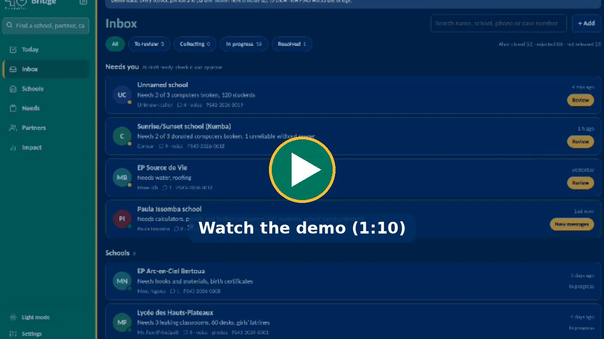

# Bridge43

Intake and AI case drafting for **PS43 Foundation**: every conversation with a school or partner in
Cameroon (WhatsApp messages and calls, field forms, uploads) becomes a structured, source-cited case draft that a PS43
staff member checks and approves.

### Demo (1:10)

[](docs/bridge43-demo.mp4)

A WhatsApp voice call to PS43 turns into a case in the Inbox, staff approve it, and Bridge43 matches the need to a
partner. [Watch or download the video](docs/bridge43-demo.mp4).

This repo covers the first two steps of the system design:

```
1a WhatsApp ─┐   (messages read from WhatsApp Desktop by the PS43 Mac app)
1b Uploads ──┤                         ┌──────────────────────────────┐
1c Calls ────┼─► convert to text ─────►│ 2. AI summary + human check  │──► approved case (JSON) ─► 3. central database
1d KoBo ─────┤   (Whisper, Claude      │   SNAP draft with citations  │
   Web form ─┘    vision, FFmpeg)      └──────────────────────────────┘
```

## What it does

| Channel | How it arrives | What happens |
|---|---|---|
| WhatsApp text, voice notes, photos, videos, documents, location pins | **Mac menu bar app** (`recorder/`) reads new one-to-one chats in WhatsApp Desktop every 20 s and posts them to `POST /api/recorder/messages` | A chat with a case is added to it; a new chat is screened by the AI and stored only if it is about schools or logistics; media converted to text |
| Field visits | KoBoToolbox REST service | Form answers and attached photos/audio become items |
| Exported WhatsApp chats | Staff upload (.zip with media, or .txt) | Parsed (iPhone + Android, English/French exports), each message and attachment becomes an item; re-uploads are de-duplicated |
| WhatsApp Desktop calls on a PS43 Mac | Same menu bar app: records when WhatsApp uses the mic | Both sides recorded, uploaded to `POST /api/recorder/calls`, transcribed with timestamps |
| Laptop calls / Wispr Notetaker / phone notes | Staff form: paste a transcript, add notes, attach recordings or photos | Same pipeline |

**Converters:** voice → Whisper (Groq, OpenAI, or local faster-whisper), photo → Claude vision,
video → FFmpeg splits sound (Whisper) and 4 frames (Claude vision), PDF → Claude.

**AI draft (SNAP = Situation, Needs, Assets, Plan):** Claude writes a structured draft per contact:
need vs. offer, organization and location, needs with urgency, offers, assets, readiness (power,
internet, storage, road access, trained staff, space), numbers, people as named, agreed next steps,
open questions, safety flags, and a confirmation message in the contact's own language. Every fact
cites the source items (`I12`), which link to the original message, photo or call on the review screen.

**School profile:** every school draft also rates the same 8 areas, so schools can be compared and scored:
safety and operation, learning space, water and toilets, teachers, materials and results, barriers for
children (fees, birth certificates, girls, disability), health and wellbeing (meals), and technology. Each is
`ok`, `partial`, `critical` or `unknown` with citations. `unknown` means "not discussed", so a school that
never mentioned water is not mistaken for one with water. The draft also records whether the school is open and
safe to reach, girls enrolled, teachers paid by parents, pupils without a birth certificate, and whether there is
an active parents' association.

**Location:** a WhatsApp location pin (read by the Mac app) is saved as a "Shared location" item and
becomes the case's map point, cited like any other fact. Map links and KoBo GPS fields work too.

**Trust level:** worked out from the evidence, not by the AI: *self-reported* (messages and calls only),
*photo-backed* (the contact sent a photo or video), *visit-confirmed* (a KoBo field visit form is in the case).

**Follow-up questions:** after each draft, Bridge43 checks 14 short profile questions (French and English) and
proposes a WhatsApp message with only the unanswered ones, at most 3 at a time, most important first (open and
safe, then name and place, biggest need, pupils, water, toilets...). Staff open it in WhatsApp from the review
screen, send it from their phone and click *I sent it*; the answers come back into the case and the next draft fills the profile. Partners, donors and
unrelated chats get no profile questions. The question bank is in `app/gaps.py`.

**One case per contact:** every contact gets a case number (`PS43-2026-0001`) as soon as they first
get in touch. Everything they send afterwards (WhatsApp texts, voice notes, photos, videos, calls recorded by the
Mac app, KoBo forms, uploads, staff notes) is filed in that same case. People are matched by phone number, and by
name when there is no number, which covers WhatsApp Desktop calls. Every new message, photo or voice note updates the case: the AI rewrites the draft from the current
record (keeping staff edits), says what changed, and sends the case back to "needs review". Staff
**close** a case to start a fresh one, and can **move** an item or **merge** two cases when one school used two
numbers. Search the inbox by case number, name or phone.

**Human check:** staff edit, approve or reject, and send the confirmation back from their own phone
(*Open in WhatsApp* / *Open in SMS*, then *I sent it* logs it in the case). Approved cases are available at `GET /api/cases` for the next stage
(priority matrix): each case comes with `trust`, `profile_complete` (0-100) and `missing_topics`, plus the
full record under `case` (profile, operating status, location, readiness, numbers, needs).

**Policy and privacy:** no bot writes to anyone: staff send every message themselves; personal chats on the PS43
laptop are screened out and never stored; group chats are never read; `STOP`/`ARRET` deletes all of a contact's
data; the Mac app uses its own token; the staff screens have no login by default (set `REQUIRE_LOGIN=true` and `STAFF_PASSWORD` to ask for one); the AI is told to
use only what the sources say and to treat their content as data, not instructions.

## Part two: from approved case to delivered help

After staff approve a case, Bridge43 carries it through to delivery and follow-up, on the staff screens
**Priorities**, **Tickets**, **Partners** and **Matching**.

**Priority matrix** (`/dashboard`): every approved school gets a **need** score (missing items in the 8 profile
areas, weighted, plus how many pupils) and a **readiness** score (power, signal, secure storage, someone to
maintain it, truck access, parents' association). Schools land in *Act now*, *Prepare first*, *Quick wins* or
*Monitor*; closed or unsafe schools go on *Safety hold*. Needs already delivered drop out of the score, so a school
moves down the matrix once helped. Filter by region. JSON: `GET /api/matrix`.

**Tickets** (`/tickets`): approving a school creates one ticket per need, with deployment steps for that kind of
help (survey, 2 quotes, build or deliver, train, school confirms with photos). Status moves New → Partner found →
In progress → Delivered → Confirmed by school. Every message to a partner or school, note and status change is
logged on the ticket (communication tracking). Staff send messages from their own phone (*Open in WhatsApp*)
and click *I sent it* to log them. When the school confirms the last need, the case is **resolved** and joins
the results log on Impact.

**Partners and donors** (`/partners`): PS43 has no fixed partner list, so the database builds itself. A donor or
partner who calls or writes is screened and summarised like a school (case type *offer*): who they are, what and
how much they can give, where, when, conditions, whether the items are abroad, and what they say about past work
with PS43. Approving the case adds or updates the partner with its items. Roles: donor, does the work (local
contractor or NGO), supplier, shipping. Staff can also add a partner they already know. Partners get their own
follow-up questions (what and how many, regions, timing, registration, contact).

**Trust** (0-100: New, Verified, Trusted) is earned from what PS43 has seen, not what partners claim: identity
checked by staff (+30), registered organisation (+5), photos or documents (+10), each case the **school confirmed**
(+15, up to 45), deliveries waiting for confirmation (+5), commitments not kept (-15).

**Matching** (`/matches`, and on each ticket): for every open need and every partner item, what they have in
common: same type of help (or related help, or money), the partner serves the school's region (a partner that says
"Northwest only" is never suggested for the Far North), quantity still needed vs. still available, and trust. When
one partner is not enough, up to 3 are combined (e.g. 25 laptops from Toronto + 15 from Yaoundé for a 40-laptop
lab), each asked only for what is still missing. Items abroad add shipping steps (ship, customs, transport) and
suggest a shipping partner. The by-type table shows where demand has no supply: where to look for new partners.

**Quote check**: each quote (total FCFA, quantity, unit) is compared with other quotes for the same kind of item on
any ticket. More than 25% above the usual unit price is flagged "ask why before accepting"; far below is flagged
"check quality".

**Follow-ups**: when a ticket is delivered, the school gets a short WhatsApp check at 30, 90 and 180 days (French or
English). Due follow-ups appear on Priorities; staff check and send. Answers land in the school's case.

**Public sign-up** (`/join`, no login, French and English): *Request help* for schools and educators, and *Offer
help* for donors, contractors, suppliers and shippers. Each form becomes an intake item in the inbox, exactly like a
WhatsApp message (AI draft, staff review), with a consent checkbox and a hidden anti-bot field. Share the link in
PS43's outreach.

**Today** (`/today`, the home page): one to-do list for a small team: new requests to check, follow-ups to send,
partners ready to confirm (one click), prices to question, deliveries gone quiet, schools in *Act now*.

**Why this priority**: every school shows one plain sentence explaining its box (gaps, pupils, vulnerability,
readiness). Staff can change every weight in **Settings** (`/settings`); nothing is a black box.

**Vulnerability**: extra need points (up to 15, adjustable or switched off) for children more at risk, counted
only from what schools say: conflict or insecurity (or a crisis-affected region, editable list; default Far North,
Northwest, Southwest), displaced or refugee pupils, pupils with a disability, orphans, and few girls enrolled.
Schools are asked about it in the follow-up questions. Numbers only, never children's names.

**Map and blind spots** (on Schools): a self-hosted map of Cameroon (no map service, works offline) with schools
coloured by box, and the regions with no request yet, where outreach should go.

**Impact** (`/impact`, printable for donors): pupils in schools helped, needs delivered, % confirmed by schools,
median days from first message to delivery, FCFA of over-priced quotes questioned, partners by trust, by region and
type, confirmed stories, and cost per case from the unit prices entered in Settings.

**Public sign-up**: a "Write on WhatsApp" button (+1 647 901 7011 by default; change it with `PUBLIC_WHATSAPP`) for
voice notes and photos, and a shorter school form (details optional).

**PS43 branding**: all screens and the public sign-up use the PS43 Brand Book colours (green #007A5E, yellow
#FDBB2F, navy #002D62, red #CE1126) and logo (`app/static/brand/`). Text and titles use Calibri for easy reading;
Carlito, its free look-alike, is bundled in `app/static/fonts/` for phones and computers without Calibri.

**Demo data**: `python -m scripts.seed_demo` loads fictional schools and partners for the whole flow (a computer lab
covered by two laptop donors and a shipper, an inflated roofing quote, a trusted borehole contractor with two
confirmed cases, a follow-up due, a school on safety hold). `--intake-only` loads only the two intake examples.

## Run it

Needs Python 3.11+ and FFmpeg (`brew install ffmpeg` / `apt install ffmpeg`).

```bash
python -m venv .venv && source .venv/bin/activate
pip install -r requirements.txt
cp .env.example .env          # add ANTHROPIC_API_KEY and TRANSCRIBE_API_KEY
python -m scripts.seed_demo   # optional: fictional demo cases, works with no keys
uvicorn app.main:app --reload
```

Open http://localhost:8000. `GET /health` lists anything missing in your configuration.

**Try it without the Mac app:** in WhatsApp, open a chat → *Export chat* → *Include media*, then upload
the .zip on **Add intake**. Voice notes are transcribed, photos described, and a draft appears ~20 s later.

### Keys

| Key | Needed for | Where |
|---|---|---|
| `ANTHROPIC_API_KEY` | AI drafts, photo/video/PDF descriptions | console.anthropic.com |
| `TRANSCRIBE_API_KEY` | Voice notes, calls, video sound | console.groq.com (free tier) or platform.openai.com; or `TRANSCRIBE_PROVIDER=local` |
| `RECORDER_TOKEN` | The Mac menu bar app (WhatsApp messages and calls) | any long random string, same in `~/.bridge43/recorder.json` |
| `KOBO_*` | Field forms | kf.kobotoolbox.org → project → Settings → REST Services |

### WhatsApp messages and calls

Build the menu bar app on the PS43 Mac (`cd recorder && ./build_app.sh`, see `recorder/README.md`), give it
Full Disk Access, Microphone and Screen & System Audio Recording, and point it at this server with the same
`RECORDER_TOKEN`. It starts at login. KoBoToolbox REST service: `{PUBLIC_BASE_URL}/webhooks/kobo?secret={KOBO_WEBHOOK_SECRET}`.

## Code map

```
app/
  main.py               FastAPI app, startup checks
  config.py             all settings (env vars)
  db.py                 SQLite storage: contacts, threads, items, summaries (swap for Postgres/Supabase here)
  consent.py            STOP / ARRET = delete everything about a contact
  triage.py             is a new WhatsApp chat about schools or logistics? (before anything is stored)
  channels/kobo.py      KoBoToolbox submissions
  channels/whatsapp_export.py   parser for WhatsApp "Export chat"
  channels/staff_intake.py      uploads and call notes
  processing/pipeline.py        item → text, background pool, debounced re-drafting
  processing/transcribe.py      Whisper (API or local)
  processing/vision.py          Claude vision for photos, video frames, PDFs
  processing/ffmpeg.py          audio/video helpers
  recorder_api.py       endpoints for the Mac menu bar app: WhatsApp messages, calls, latest cases
  summary.py            SNAP schema + school profile, prompt, citation checks
  gaps.py               follow-up questions (14 for schools, 7 for donors) and which are still unanswered
  scoring.py            need and readiness scores, priority matrix boxes
  matching.py           regions, quantities, partner trust, need-to-partner matching, quote price check
  workflow.py           approval hook, tickets and steps, partners database, messages, follow-ups
  ops_web.py            Priorities, Tickets, Partners, Matching screens and their JSON APIs
  public_web.py         public /join sign-up forms (French/English)
  evidence.py           trust level and map location, worked out from the items
  web.py + templates/   inbox, intake forms, review screen, JSON API
recorder/               Mac call recorder (Swift) - see recorder/README.md
scripts/seed_demo.py    fictional demo data
tests/                  end-to-end tests with fake AI providers (pytest)
```

Run the tests: `pip install -r requirements-dev.txt && pytest`
